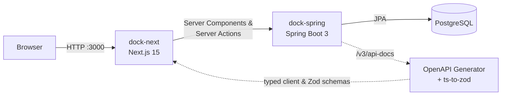

# Docker · Spring Boot · Next.js

[](https://github.com/inhaltone/docker.spring.next/actions/workflows/ci.yml)


A full-stack proof-of-concept starter: a **Spring Boot** REST API and a **Next.js** UI, wired together with
**Docker Compose** and connected by a **type-safe contract generated from OpenAPI**.

The backend is intentionally framework-driven, with no custom plumbing. Spring Data, Bean Validation, Problem Details
and springdoc do the work.

## Architecture



| Layer    | Stack                                                                                     |
|----------|-------------------------------------------------------------------------------------------|
| Backend  | Java 21, Spring Boot 3.4, Spring Data JPA, Bean Validation, springdoc-openapi, Actuator   |
| Frontend | Next.js 15, React 19, Server Actions, Tailwind CSS, shadcn/ui, Zod                         |
| Contract | `typescript-fetch` client from OpenAPI Generator (custom template) plus Zod via `ts-to-zod` |
| Infra    | Docker Compose, PostgreSQL 17, multi-stage Dockerfiles, GitHub Actions CI                 |

## Highlights

- **Framework-driven API.** Each controller talks straight to a `JpaRepository`. `Pageable` and `PagedModel` handle
  paging, `@Valid` handles validation, and `ResponseStatusException` plus `spring.mvc.problemdetails.enabled` return
  [RFC 9457](https://www.rfc-editor.org/rfc/rfc9457) errors.
- **End-to-end types.** The TypeScript client and Zod schemas are generated from the live OpenAPI spec, so a backend
  change shows up as a compile error in the frontend.
- **Server-side data access.** Next.js calls the API only from Server Components and Server Actions, so the browser
  needs no CORS setup and the API URL stays internal.
- **One-command setup.** `docker compose up` starts the database, API and UI with health-checked startup ordering.

## Quick start

Prerequisites: Docker with Docker Compose.

```bash
git clone https://github.com/inhaltone/docker.spring.next.git
cd docker.spring.next
cp .env.example .env
docker compose up --build
```

| Service    | URL                                   |
|------------|---------------------------------------|
| Web app    | http://localhost:3000                 |
| Swagger UI | http://localhost:8080/swagger-ui.html |
| OpenAPI    | http://localhost:8080/v3/api-docs     |
| Health     | http://localhost:8080/actuator/health |

Stop with `docker compose down`. Add `-v` to also drop the database volume.

## Local development (without Docker for apps)

```bash
# 1. Database only
docker compose up -d postgres

# 2. API (Java 21). Uses localhost:5433 by default, override with SPRING_DATASOURCE_* env vars
cd dock-spring && ./mvnw spring-boot:run

# 3. Web
cd dock-next && npm install && npm run dev
```

## API

| Method   | Path                  | Description                               |
|----------|-----------------------|-------------------------------------------|
| `GET`    | `/api/engineers`      | Paged list (`?page=0&size=10&sort=id`)    |
| `GET`    | `/api/engineers/{id}` | Get one (`404` if missing)                |
| `POST`   | `/api/engineers`      | Create (`400` invalid, `409` email taken) |
| `DELETE` | `/api/engineers/{id}` | Delete (`204`)                            |
| `GET`    | `/api/users`          | Paged list of users                       |

## Regenerating the client

Whenever the API changes, start the backend and run:

```bash
cd dock-next
npm run generate   # OpenAPI -> src/api/openapi, then models -> src/schemas (Zod)
```

The generator uses the custom Mustache template in `dock-next/templates` to emit plain interfaces.

## Project structure

```
.
├── docker-compose.yml        # postgres + dock-spring + dock-next
├── dock-spring/              # Spring Boot API
│   └── src/main/java/com/gendy/dockspring/
│       ├── uniengineers/     # entity, repository, controller
│       └── users/
└── dock-next/                # Next.js app
    ├── scripts/              # OpenAPI + Zod generators
    ├── templates/            # custom openapi-generator template
    └── src/
        ├── actions/          # Server Actions
        ├── api/              # client config + generated client
        ├── app/              # routes
        └── schemas/          # generated Zod schemas
```

## Tests

```bash
cd dock-spring && ./mvnw test                         # MockMvc integration tests on embedded H2
cd dock-next && npm run lint && npm run typecheck
```

## License

[MIT](LICENSE)
