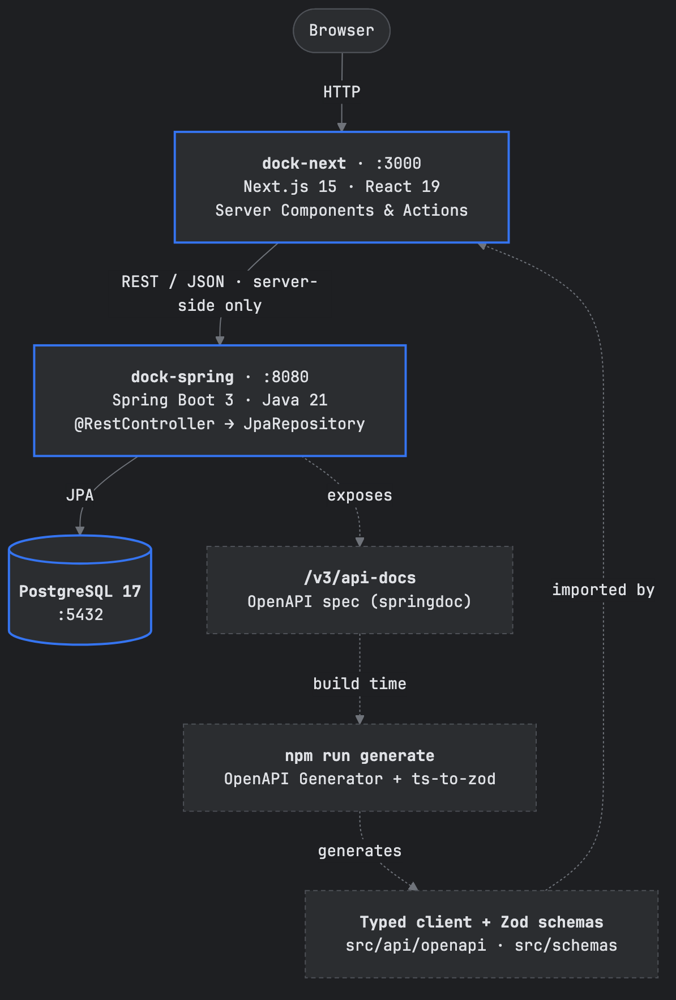
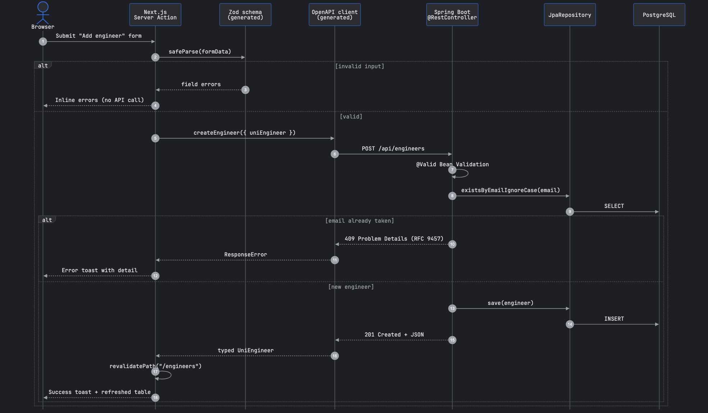

# Docker · Spring Boot · Next.js

A full-stack proof-of-concept starter with an end-to-end, type-safe contract
from a Spring Boot API to a Next.js UI, wired together by Docker Compose.

[](https://github.com/inhaltone/docker.spring.next/actions/workflows/ci.yml)


## Overview

- **Framework-driven backend.** No custom plumbing. Spring Data handles persistence and paging, Bean Validation checks input, and Problem Details formats errors.
- **One source of truth.** The OpenAPI spec generates the TypeScript client and Zod schemas, so a backend change breaks the frontend build instead of production.
- **Server-side data access.** Next.js calls the API only from Server Components and Server Actions. The browser never talks to Spring, so CORS isn't needed.
- **One command.** `docker compose up` starts PostgreSQL, the API and the UI, using health-checked startup ordering.

## How it works

### Architecture

<p align="center">
  
</p>

1. **Runtime (solid arrows).** The browser only talks to **Next.js**. Server Components read data and Server Actions
   write it, both through a generated client that calls the **Spring Boot** REST API. The API persists data to
   **PostgreSQL** through Spring Data JPA.
2. **Build time (dotted arrows).** springdoc publishes the OpenAPI spec at `/v3/api-docs`. `npm run generate` turns it
   into a typed `fetch` client and Zod schemas, which the Next.js app imports.

### Request flow: adding an engineer

<p align="center">
  
</p>

Validation runs at both layers. The **generated Zod schema** rejects bad input before any network call, and
**Bean Validation** (`@Valid`) protects the API itself. Every error comes back as an
[RFC 9457 Problem Details](https://www.rfc-editor.org/rfc/rfc9457) response and is shown to the user as a toast.

## Tech stack

| Layer    | Stack                                                                                       |
|----------|---------------------------------------------------------------------------------------------|
| Backend  | Java 21 · Spring Boot 3.4 · Spring Data JPA · Bean Validation · springdoc-openapi · Actuator |
| Frontend | Next.js 15 (App Router) · React 19 · Server Actions · Tailwind CSS · shadcn/ui · Zod         |
| Contract | OpenAPI Generator `typescript-fetch` (custom Mustache template) · `ts-to-zod`               |
| Infra    | Docker Compose · PostgreSQL 17 · multi-stage, non-root images · GitHub Actions CI           |

## Quick start

**Prerequisites:** Docker with Docker Compose.

```bash
git clone https://github.com/inhaltone/docker.spring.next.git
cd docker.spring.next
cp .env.example .env
docker compose up --build
```

| Service    | URL                                    |
|------------|----------------------------------------|
| Web app    | http://localhost:3000                  |
| Swagger UI | http://localhost:8080/swagger-ui.html  |
| OpenAPI    | http://localhost:8080/v3/api-docs      |
| Health     | http://localhost:8080/actuator/health  |

Stop with `docker compose down`. Add `-v` to also remove the database volume.

## API

| Method   | Path                  | Description                                     |
|----------|-----------------------|-------------------------------------------------|
| `GET`    | `/api/engineers`      | Paged list: `?page=0&size=10&sort=id`           |
| `GET`    | `/api/engineers/{id}` | Get one (`404` if missing)                      |
| `POST`   | `/api/engineers`      | Create (`201`, `400` invalid, `409` email taken) |
| `DELETE` | `/api/engineers/{id}` | Delete (`204`)                                  |
| `GET`    | `/api/users`          | Paged list of users                             |

<details>
<summary>Example requests</summary>

```bash
curl -X POST localhost:8080/api/engineers \
  -H 'Content-Type: application/json' \
  -d '{"firstName":"Ada","email":"ada@example.com"}'
# {"id":1,"firstName":"Ada","email":"ada@example.com"}

curl localhost:8080/api/engineers
# {"content":[{"id":1,...}],"page":{"size":10,"number":0,"totalElements":1,"totalPages":1}}

# Same email again → 409 Problem Details
# {"type":"about:blank","title":"Conflict","status":409,"detail":"Email ada@example.com is already registered","instance":"/api/engineers"}
```

</details>

## Local development

Run the apps on your machine and only the database in Docker:

```bash
docker compose up -d postgres                 # 1. database on localhost:5433
cd dock-spring && ./mvnw spring-boot:run      # 2. API on :8080 (Java 21)
cd dock-next && npm install && npm run dev    # 3. UI on :3000
```

### Regenerating the contract

Whenever the API changes, start the backend and run:

```bash
cd dock-next
npm run generate          # OpenAPI → src/api/openapi, then models → src/schemas (Zod)
```

Set `OPENAPI_SPEC` to read the spec from another URL or a local file. Use `npm run generate:api:docker` if you don't
have Java installed locally.

### Tests

```bash
cd dock-spring && ./mvnw test                     # MockMvc integration tests on embedded H2
cd dock-next && npm run lint && npm run typecheck
```

## Project structure

```
.
├── docker-compose.yml          # postgres + dock-spring + dock-next
├── docs/diagrams/              # Mermaid sources (.mmd) + rendered PNGs
├── dock-spring/                # Spring Boot API
│   └── src/main/java/com/gendy/dockspring/
│       ├── uniengineers/       # entity · repository · controller
│       └── users/
└── dock-next/                  # Next.js app
    ├── scripts/                # OpenAPI + Zod generators
    ├── templates/              # custom openapi-generator template
    └── src/
        ├── actions/            # Server Actions
        ├── api/                # client config + generated client
        ├── app/                # routes
        └── schemas/            # generated Zod schemas
```

<details>
<summary>Editing the diagrams</summary>

The diagrams are written in [Mermaid](https://mermaid.js.org) in `docs/diagrams/*.mmd`. They're rendered to PNG with a
JetBrains-style dark palette (`mermaid-config.json`):

```bash
./docs/diagrams/render.sh
```

</details>

## License

[MIT](LICENSE) © inhaltone
